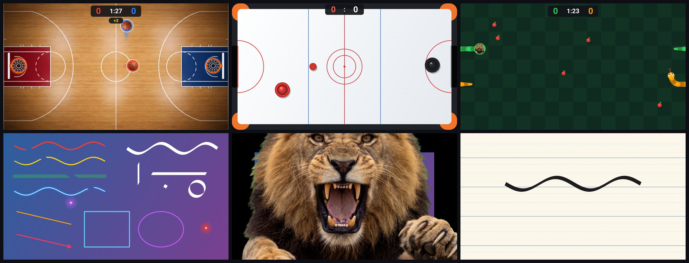
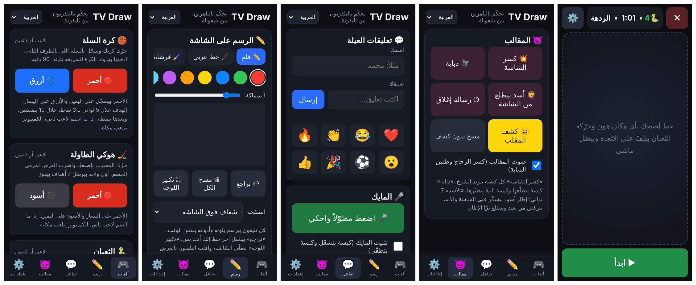

<div align="center" dir="rtl">

# TV Draw: متعة وتعلّم على تلفزيونك

**حوّل أي تلفزيون أندرويد لشاشة عائلية مشتركة، تتحكم فيها من متصفح تليفونك.**
ألعاب، رسم، خط عربي، تعليقات، مايك مباشر، مقالب خفيفة وتنبيه للصلاة.

[](https://github.com/madmoh11/TV-FUN-LEARN/actions/workflows/build.yml)
[](LICENSE)


[English](README.md) | **العربية**



</div>

<div dir="rtl">

## ما هو؟

TV Draw تطبيق صغير لتلفزيونات وأجهزة أندرويد تي في. يرسم فوق أي شيء معروض على الشاشة: فيلم، مباراة، أو الشاشة
الرئيسية. كل شخص في الغرفة يتحكم فيه من تليفونه بفتح صفحة ويب. التليفونات لا تحتاج تطبيقاً ولا حساباً، ولا شيء
يخرج من شبكة البيت.



## المميزات

| | |
| --- | --- |
| 🎮 **ألعاب** | كرة السلة، هوكي الطاولة والثعبان. لاعب واحد ضد الكمبيوتر، أو تليفونان ضد بعض. |
| ✏️ **رسم** | أكثر من تليفون يرسم في نفس الوقت. قلم، فرشاة، هايلايتر، نيون، ممحاة، أشكال وقصبة للخط العربي. |
| 📄 **صفحات** | ارسم فوق الصورة، أو على ورقة مسطّرة، كرّاسة خط، مربعات، نقاط أو سبورة. |
| 🔦 **مؤشر** | نقطة ليزر أو كشّاف، تحركه بإصبعك أو بميلان التليفون. |
| 💬 **تعليقات العيلة** | أسماء ورسائل وإيموجي تطير على الشاشة. |
| 🎤 **مايك** | تكلّم في تليفونك ويطلع صوتك من سماعات التلفزيون. |
| 🖼️ **صور** | اعرض صورة من تليفونك على التلفزيون. |
| 😈 **مقالب** | كسر الشاشة، ذبابة تمشي، أسد يقفز من الشاشة، ورسالة إغلاق وهمية. |
| 🕌 **تنبيه الصلاة** | شريط قبل كل صلاة، محسوب على الجهاز بدون إنترنت. |
| 🌍 **اللغات** | العربية والإنجليزية، مع [طريقة سهلة لإضافة لغات](docs/TRANSLATING.md). |

## التثبيت

تحتاج تلفزيون أو بوكس أندرويد (أندرويد 8 أو أحدث)، وتليفون على نفس الواي فاي، وطريقة لإرسال أوامر `adb`
للتلفزيون: كمبيوتر عليه [platform-tools](https://developer.android.com/tools/releases/platform-tools)، أو تطبيق
ADB على تليفونك.

1. على التلفزيون فعّل **خيارات المطوّر ← تصحيح USB** (أو **تصحيح الشبكة**).
2. نزّل `tv-draw.apk` من [آخر إصدار](https://github.com/madmoh11/TV-FUN-LEARN/releases/latest).
3. ثبّته واسمح له بالظهور فوق التطبيقات. بدّل العنوان بعنوان IP تلفزيونك:

</div>

```bash
adb connect 192.168.1.50
adb install tv-draw.apk
adb shell appops set com.mohammad.tvdraw SYSTEM_ALERT_WINDOW allow
```

<div dir="rtl">

4. افتح **TV Draw** من قائمة تطبيقات التلفزيون. ستظهر بطاقة فيها عنوان ورمز QR.
5. افتح العنوان في متصفح تليفونك، أو امسح رمز QR.

الأمر الثالث مهم: بدون هذا الإذن يُغلق التطبيق فور تشغيله.

## معلومات مفيدة

- **الرابط الآمن.** المتصفحات لا تسمح بالمايك وحساسات الميلان إلا على `https`. الصفحة تعرض رابطاً آمناً، وسيحذّرك
  المتصفح أن الاتصال «غير خاص» لأن التلفزيون يوقّع شهادته بنفسه. اختر *خيارات متقدمة ← متابعة*. كل تلفزيون يولّد
  مفتاحه الخاص عند أول تشغيل.
- **من يستطيع التحكم.** أي شخص على نفس الواي فاي يفتح العنوان. استخدمه على شبكة بيت تثق بها.
- **الخصوصية.** لا حسابات، لا تتبّع، ولا حاجة للإنترنت. الصوت والصور تذهب من التليفون للتلفزيون مباشرة ولا تُحفظ.
- **المتصفحات.** إذا لم تفتح الصفحة في متصفح، جرّب غيره (متصفح سامسونج، كروم، فايرفوكس).
- **تمت التجربة على** Xiaomi Mi Box بنظام أندرويد 9. الأجهزة الأخرى يُفترض أن تعمل، ونرحّب
  [بملاحظاتك](https://github.com/madmoh11/TV-FUN-LEARN/issues).

## البناء من الكود

</div>

```bash
./gradlew assembleDebug
```

<div dir="rtl">

التفاصيل والاختبارات وتنظيم الكود في [docs/BUILDING.md](docs/BUILDING.md).

## المساهمة

الأفكار وبلاغات الأخطاء والترجمات مرحّب بها. راجع [CONTRIBUTING.md](CONTRIBUTING.md).

## شكر وتقدير

تصميم وتطوير **محمد الجاعوني** ([@madmoh11](https://github.com/madmoh11)).

شكر خاص لـ **Gravity Sound** على تسجيلات كسر الزجاج الحقيقية التي يقوم عليها مقلب كسر الشاشة، والمنشورة برخصة
CC BY 4.0. التفاصيل الكاملة في [CREDITS.md](CREDITS.md).

## الرخصة

[MIT](LICENSE) © 2026 محمد الجاعوني

</div>
