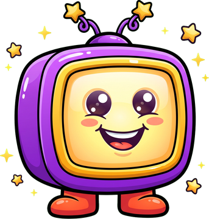
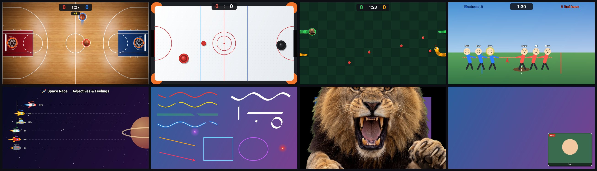
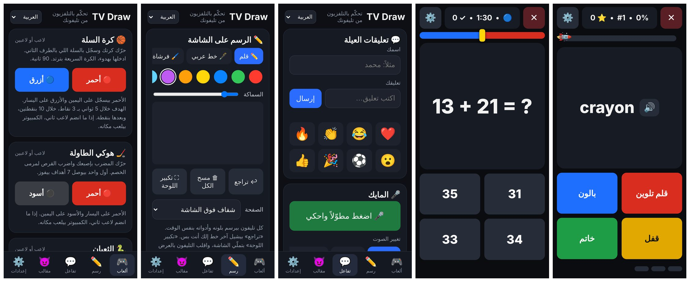

<div align="center" dir="rtl">



# لمّة (Lamma): متعة وتعلّم على تلفزيونك

**حوّل أي تلفزيون أندرويد لشاشة عائلية مشتركة، تتحكم فيها من متصفح تليفونك.**
ألعاب عائلية، ألعاب تعليمية للحساب والإنجليزية، رسم، خط عربي، كاميرا ومايك مباشر،
مقالب خفيفة وتنبيه للصلاة.

[](https://github.com/madmoh11/TV-FUN-LEARN/actions/workflows/build.yml)
[](LICENSE)


[English](README.md) | **العربية**



</div>

<div dir="rtl">

## ما هو؟

لمّة تطبيق صغير لتلفزيونات وأجهزة أندرويد تي في. يرسم فوق أي شيء معروض على الشاشة: فيلم، مباراة، أو الشاشة
الرئيسية. كل شخص في الغرفة يتحكم فيه من تليفونه بفتح صفحة ويب. التليفونات لا تحتاج تطبيقاً ولا حساباً، ولا شيء
يخرج من شبكة البيت.



## المميزات

| | |
| --- | --- |
| 🎮 **ألعاب** | خمس ألعاب تُلعب على التلفزيون والتليفونات هي أذرع التحكم: راجع [الألعاب](#الألعاب) في الأسفل. |
| ✏️ **رسم** | أكثر من تليفون يرسم في نفس الوقت. قلم، فرشاة، هايلايتر، نيون، ممحاة، أشكال وقصبة للخط العربي. |
| 📄 **صفحات** | ارسم فوق الصورة، أو على ورقة مسطّرة، كرّاسة خط، مربعات، نقاط أو سبورة. |
| 🔦 **مؤشر** | نقطة ليزر أو كشّاف، تحركه بإصبعك أو بميلان التليفون. |
| 💬 **تعليقات العيلة** | أسماء ورسائل وإيموجي تطير على الشاشة. |
| 🎤 **مايك** | تكلّم في تليفونك ويطلع صوتك من سماعات التلفزيون. |
| 🎭 **تغيير الصوت** | تكلّم بصوت وحش، رجل خشن، أنثى، طفل، سنجاب، روبوت، كائن فضائي، أو بصدى كهف. |
| 📹 **كاميرا مباشرة** | كاميرا تليفونك في زاوية التلفزيون، مثل مراسل في البيت. اختر الزاوية والحجم حتى ملء الشاشة. |
| 🖼️ **صور** | اعرض صورة من تليفونك على التلفزيون. |
| 🏆 **لوحة الشرف** | كل لاعب مسجّل باسمه يجمع نقاطاً من كل الألعاب، مع أبطال أسبوعيين. محفوظة على التلفزيون. |
| 🗳️ **تصويت سريع** | اطرح سؤالاً، والكل يصوّت من تليفونه، والنتيجة تظهر على التلفزيون. |
| ⏱️ **مؤقّت العيلة** | عدّ تنازلي في زاوية التلفزيون مع تنبيه كبير عند انتهاء الوقت. |
| 🔊 **الصوت** | ارفع صوت البوكس أو اخفضه أو اكتمه من تليفونك. |
| 😈 **مقالب** | كسر الشاشة، ذبابة تمشي، أسد يقفز من الشاشة، ورسالة إغلاق وهمية. |
| 🕌 **تنبيه الصلاة** | شريط قبل كل صلاة، محسوب على الجهاز بدون إنترنت. |
| 🌍 **اللغات** | العربية والإنجليزية، مع [طريقة سهلة لإضافة لغات](docs/TRANSLATING.md). |

## الألعاب

| اللعبة | اللاعبون | طريقة اللعب |
| --- | --- | --- |
| 🏀 **كرة السلة** | 1 أو 2 | حرّك كرتك بالعصا أو بميلان التليفون وسجّل في السلة المقابلة. الهدف الأسرع بنقاط أكثر. |
| 🏒 **هوكي الطاولة** | 1 أو 2 | حرّك المضرب بإصبعك واضرب القرص لمرمى الخصم. أول من يصل 7 أهداف يفوز. |
| 🐍 **الثعبان** | 1 أو 2 | كُل لتطول وتجنّب الاصطدام. اخرج من طرف الشاشة وارجع من الطرف المقابل. يمكنك وضع وجهك على الثعبان. |
| 🪢 **شد الحبل الحسابية** | من 1 إلى 6 | فريقان يحلّان مسائل على التليفونات، وكل إجابة صحيحة تسحب الحبل. سهل، متوسط، صعب أو متدرّج. ضربة قاضية، وقت محدد وموت مفاجئ. |
| 🚀 **سباق الصواريخ** | من 1 إلى 6 | تظهر كلمة إنجليزية على التليفون وتختار معناها بالعربي. الإجابات الصحيحة تطيّر صاروخك نحو الكوكب. |

كل الألعاب تُلعب بلاعب واحد أيضاً: الكمبيوتر يأخذ الجهة الفارغة.

### الألعاب التعليمية بالتفصيل

**شد الحبل الحسابية.** الجمع والطرح بنقطة، الضرب والقسمة بنقطتين، والمسائل بعمليتين بثلاث أو أربع نقاط. الإجابة الخاطئة
تجمّد شاشتك لحظات وترخي الحبل. خمس إجابات صحيحة متتالية تضاعف قوتك خمس ثوانٍ. الفريق الأقل عدداً يسحب أقوى، فلاعب
سريع واحد يقدر يواجه أكثر من لاعب. شاشة النهاية تعرض أكثر لاعب أجاب صحيحاً وأسرع لاعب.

**سباق الصواريخ.** اللعبة فيها 1000 كلمة إنجليزية في عشر «مجرات»: الحيوانات والطبيعة، الأفعال والحركة، المدرسة والأدوات،
الطعام والشراب، الصفات والمشاعر، المنزل والعائلة، المهن والأماكن، الوقت والطقس، الفضاء والتكنولوجيا، والتحدي الشامل.
وهي مصممة للتعليم لا لجمع النقاط فقط:

- الكلمة التي أجبتها صحيحاً لا تعود حتى تنهي مجرتها.
- الكلمة التي أخطأت فيها تعود حتى تجيبها صحيحاً مرتين.
- الخيارات الخاطئة من نفس المجرة ونفس الصعوبة، فالتخمين صعب.
- التليفون ينطق كل كلمة.
- بعد السباق يعرض التلفزيون الكلمات التي أُخطئ فيها مع معانيها.
- الإجابة خلال 2.5 ثانية لها مكافأة، وثلاث إجابات متتالية تشحن التيربو، وكل خامس سؤال نيزك ذهبي.
- كل 50 كلمة متقنة تفتح مركبة فضائية جديدة. التقدم محفوظ على كل تليفون.

الكلمات موجودة في [`words_bank.json`](app/src/main/assets/data/words_bank.json) ويمكن الزيادة عليها بدون تعديل الكود.

## التثبيت

تحتاج تلفزيون أو بوكس أندرويد (أندرويد 8 أو أحدث)، وتليفون على نفس الواي فاي، وطريقة لإرسال أوامر `adb`
للتلفزيون: كمبيوتر عليه [platform-tools](https://developer.android.com/tools/releases/platform-tools)، أو تطبيق
ADB على تليفونك.

1. على التلفزيون فعّل **خيارات المطوّر ← تصحيح USB** (أو **تصحيح الشبكة**).
2. نزّل `lamma.apk` من [آخر إصدار](https://github.com/madmoh11/TV-FUN-LEARN/releases/latest).
3. ثبّته واسمح له بالظهور فوق التطبيقات. بدّل العنوان بعنوان IP تلفزيونك:

</div>

```bash
adb connect 192.168.1.50
adb install lamma.apk
adb shell appops set com.mohammad.tvdraw SYSTEM_ALERT_WINDOW allow
```

<div dir="rtl">

4. افتح **لمّة** من قائمة تطبيقات التلفزيون. ستظهر بطاقة فيها عنوان ورمز QR.
5. افتح العنوان في متصفح تليفونك، أو امسح رمز QR.

الأمر الثالث مهم: بدون هذا الإذن يُغلق التطبيق فور تشغيله.

## معلومات مفيدة

- **الرابط الآمن.** المتصفحات لا تسمح بالمايك والكاميرا وحساسات الميلان إلا على `https`. الصفحة تعرض رابطاً آمناً، وسيحذّرك
  المتصفح أن الاتصال «غير خاص» لأن التلفزيون يوقّع شهادته بنفسه. اختر *خيارات متقدمة ← متابعة*. كل تلفزيون يولّد
  مفتاحه الخاص عند أول تشغيل.
- **من يستطيع التحكم.** أي شخص على نفس الواي فاي يفتح العنوان. استخدمه على شبكة بيت تثق بها.
- **الخصوصية.** لا حسابات، لا تتبّع، ولا حاجة للإنترنت. الصوت والكاميرا والصور تذهب من التليفون للتلفزيون مباشرة ولا تُحفظ. تقدّم التعلّم يبقى في متصفح التليفون.
- **المتصفحات.** إذا لم تفتح الصفحة في متصفح، جرّب غيره (متصفح سامسونج، كروم، فايرفوكس).
- **تمت التجربة على** Xiaomi Mi Box بنظام أندرويد 9. الأجهزة الأخرى يُفترض أن تعمل، ونرحّب
  [بملاحظاتك](https://github.com/madmoh11/TV-FUN-LEARN/issues).

## البناء من الكود

</div>

```bash
./gradlew assembleDebug
```

<div dir="rtl">

التفاصيل والاختبارات وتنظيم الكود في [docs/BUILDING.md](docs/BUILDING.md).

## المساهمة

الأفكار وبلاغات الأخطاء والترجمات مرحّب بها. راجع [CONTRIBUTING.md](CONTRIBUTING.md).

## شكر وتقدير

تصميم وتطوير **محمد الجاعوني** ([@madmoh11](https://github.com/madmoh11)).

شكر خاص لـ **Gravity Sound** على تسجيلات كسر الزجاج الحقيقية التي يقوم عليها مقلب كسر الشاشة، والمنشورة برخصة
CC BY 4.0. التفاصيل الكاملة في [CREDITS.md](CREDITS.md).

## الرخصة

[MIT](LICENSE) © 2026 محمد الجاعوني

</div>
