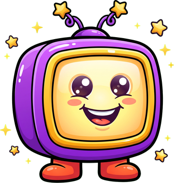
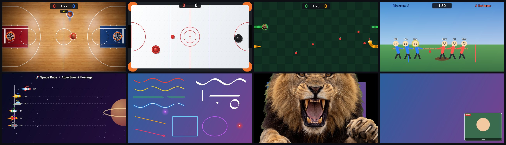
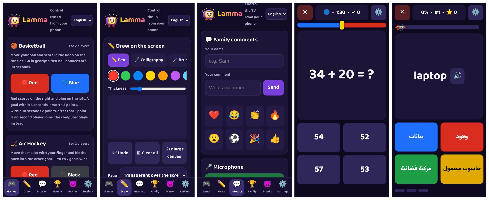

<div align="center">



# Lamma (لمّة): fun and learning on your TV

**Turn any Android TV into a shared family screen, controlled from your phone's browser.**
Family games, learning games for maths and English, drawing, Arabic calligraphy, a live camera and microphone,
harmless pranks and prayer alerts.

[](https://github.com/madmoh11/TV-FUN-LEARN/actions/workflows/build.yml)
[](LICENSE)


**English** | [العربية](README.ar.md)



</div>

## What is it?

Lamma (Arabic for a family get-together) is a small app for Android TV and TV boxes. It draws on top of whatever is on the screen: a film, a football
match, the home screen. Everyone in the room controls it from their own phone by opening a web page. Phones need no app
and no account, and nothing leaves your home network.



## Features

| | |
| --- | --- |
| 🎮 **Games** | Five games played on the TV with phones as controllers: see [the games](#the-games) below. |
| ✏️ **Drawing** | Several phones draw at once. Pen, brush, highlighter, neon, eraser, shapes and an Arabic calligraphy nib. |
| 📄 **Pages** | Draw over the picture, or on ruled paper, a calligraphy sheet, squares, dots or a blackboard. |
| 🔦 **Pointer** | A laser dot or a spotlight, moved by finger or by tilting the phone. |
| 💬 **Family comments** | Names, messages and emoji float across the screen. |
| 🎤 **Microphone** | Talk into your phone and be heard from the TV speakers. |
| 🎭 **Voice changer** | Speak as a monster, a deep-voiced man, a woman, a child, a chipmunk, a robot, an alien, or with a cave echo. |
| 📹 **Live camera** | Your phone camera in a corner of the TV, like a reporter at home. Pick the corner and the size, up to full screen. |
| 🖼️ **Pictures** | Show a photo from your phone on the TV. |
| 🏆 **Hall of fame** | Every named player collects points from all the games, with weekly champions. Saved on the TV. |
| 🗳️ **Quick vote** | Ask a question, everyone votes from their phone, and the result appears on the TV. |
| ⏱️ **Family timer** | A countdown in the corner of the TV with a big alert when time is up. |
| 📣 **Call the family** | "Dinner is ready", "Bedtime" or your own message on the TV with a chime, now or every day at a set time. |
| ✅ **Kids' chores** | Chores with points: a finished chore adds to the family board and the TV celebrates. |
| 📖 **The memoriser's journey** | Learn the Quran by heart: listen and repeat with Al-Husary while the words hide, recite from memory with a grown-up marking each ayah, and revise each part on the right day. |
| 🔊 **Volume** | Turn the TV box volume up, down or mute it from your phone. |
| 😈 **Pranks** | Cracked screen, a fly that walks around (any size, with a shadow), a person's shadow that walks past like in a cinema, a lion that jumps out of the screen, a fake shutdown message. |
| 🕌 **Prayer alert** | A banner before each prayer, calculated on the device with no internet. |
| 🌍 **Languages** | English and Arabic, with [an easy way to add more](docs/TRANSLATING.md). |

## The games

| Game | Players | How it works |
| --- | --- | --- |
| 🏀 **Basketball** | 1 or 2 | Move your ball with a joystick or by tilting the phone and score in the far hoop. Faster goals are worth more points. |
| 🏒 **Air hockey** | 1 or 2 | Slide the mallet with your finger and hit the puck into the other goal. First to 7 wins. |
| 🐍 **Snake** | 1 or 2 | Eat to grow and avoid crashing. Leave one edge and come back from the other. You can put your own face on the snake. |
| 🪢 **Math tug of war** | 1 to 6 | Two teams solve sums on their phones; every correct answer pulls the rope. Easy, medium, hard, or a level that gets harder. Knockout, time limit and sudden death. |
| 🚀 **Space race** | 1 to 6 | An English word appears on the phone and you pick its Arabic meaning. Correct answers fly your rocket to the planet. |
| 🌍 **Flags, capitals and spelling** | 1 to 6 | One question on the TV for everybody: a flag, a country, or a spoken English word. Answer on your phone; faster right answers earn more. |
| 🕺 **Move to the beat** | 1 or 2 | A workout on the beat: step left or right, jump or duck as the moves reach the line. The phone in your hand senses the movement. |

Every game can be played alone: the computer takes the empty side.

### Learning games in detail

**Math tug of war.** Easy sums are worth 1 point, multiplying and dividing 2, and two-step sums 3 or 4. A wrong answer
freezes your screen for a moment and lets the rope slip. Five correct answers in a row double your pull for five
seconds. A smaller team pulls harder, so one fast player can stand against several. The end screen names the player
with the most correct answers and the fastest one.

**Space race.** The game ships with 1,000 English words in ten "galaxies": animals and nature, action verbs, school and
objects, food and drinks, adjectives and feelings, home and family, jobs and places, time and weather, space and
technology, and a master challenge. It is built to teach, not only to score:

- A word you answered correctly does not come back until you finish its galaxy.
- A word you got wrong keeps coming back until you answer it right twice.
- The wrong choices come from the same galaxy and difficulty, so guessing is hard.
- The phone can say each word aloud.
- After the race the TV shows the words that were missed, with their meanings.
- Answering within 2.5 seconds gives a bonus, three in a row charge a turbo, and every fifth question is a golden meteor.
- Every 50 mastered words unlock a new spacecraft. Progress is saved on each phone.

The words live in [`words_bank.json`](app/src/main/assets/data/words_bank.json) and can be extended without touching the code.

## Install

You need an Android TV or TV box (Android 8 or newer), a phone on the same Wi-Fi, and a way to send `adb` commands
to the TV: a computer with [platform-tools](https://developer.android.com/tools/releases/platform-tools), or an ADB
app on your phone.

1. On the TV, turn on **Developer options → USB debugging** (or **Network debugging**).
2. Download `lamma.apk` from the [latest release](https://github.com/madmoh11/TV-FUN-LEARN/releases/latest).
3. Install it and allow it to draw over other apps. Replace the address with your TV's IP address:

   ```bash
   adb connect 192.168.1.50
   adb install lamma.apk
   adb shell appops set com.mohammad.tvdraw SYSTEM_ALERT_WINDOW allow
   ```

4. Open **Lamma** from the TV's app list. A card appears with an address and a QR code.
5. Open that address in your phone's browser, or scan the QR code.

The second command in step 3 matters: without that permission the app closes as soon as it starts.

## Good to know

- **The secure link.** Browsers only allow the microphone, the camera and the tilt sensors on `https`. The page offers a secure
  link; your browser will warn that the connection is "not private" because the TV signs its own certificate.
  Choose *Advanced → Proceed*. Each TV creates its own key the first time the app runs.
- **Who can control the TV.** Anyone on the same Wi-Fi who opens the address. Use it on a home network you trust.
- **Privacy.** No accounts, no analytics, no internet access needed. Voice, camera and pictures go from the phone
  straight to the TV and are not saved. Learning progress stays in the phone's browser.
- **Browsers.** If the page does not open in one browser, try another one (Samsung Internet, Chrome, Firefox).
- **Tested on** a Xiaomi Mi Box running Android 9. Other devices should work; please
  [report](https://github.com/madmoh11/TV-FUN-LEARN/issues) what you find.

## Build it yourself

```bash
./gradlew assembleDebug
```

Details, tests and code layout are in [docs/BUILDING.md](docs/BUILDING.md).

## Contributing

Ideas, bug reports and translations are welcome. See [CONTRIBUTING.md](CONTRIBUTING.md).

## Credits and thanks

Designed and developed by **Mohammad Aljaouni** ([@madmoh11](https://github.com/madmoh11)).

Special thanks to **Gravity Sound** for the real breaking-glass recordings behind the cracked-screen prank,
shared under CC BY 4.0. Full details are in [CREDITS.md](CREDITS.md).

## Licence

[MIT](LICENSE) © 2026 Mohammad Aljaouni
