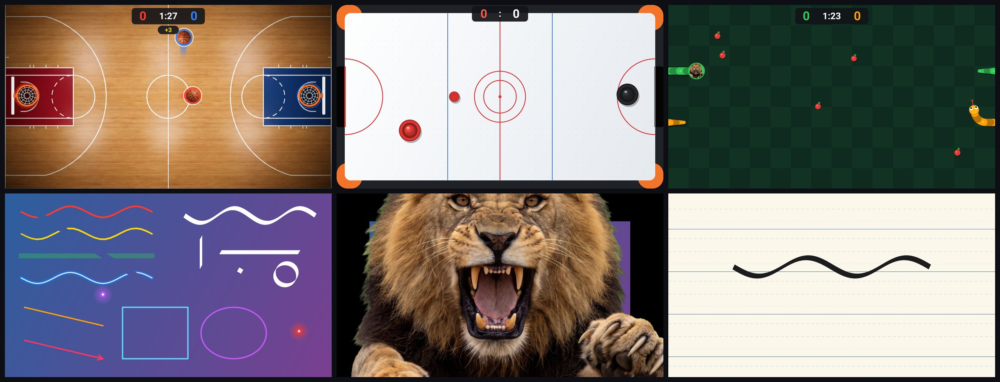
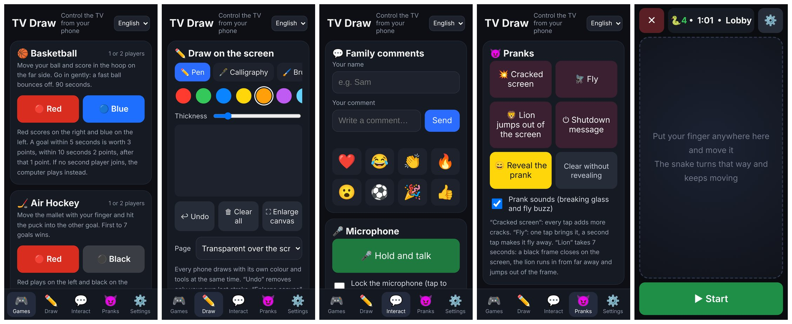

<div align="center">

# TV Draw: fun and learning on your TV

**Turn any Android TV into a shared family screen, controlled from your phone's browser.**
Games, drawing, Arabic calligraphy, comments, a live microphone, harmless pranks and prayer alerts.

[](https://github.com/madmoh11/TV-FUN-LEARN/actions/workflows/build.yml)
[](LICENSE)


**English** | [العربية](README.ar.md)



</div>

## What is it?

TV Draw is a small app for Android TV and TV boxes. It draws on top of whatever is on the screen: a film, a football
match, the home screen. Everyone in the room controls it from their own phone by opening a web page. Phones need no app
and no account, and nothing leaves your home network.



## Features

| | |
| --- | --- |
| 🎮 **Games** | Basketball, air hockey and snake. One player against the computer, or two phones against each other. |
| ✏️ **Drawing** | Several phones draw at once. Pen, brush, highlighter, neon, eraser, shapes and an Arabic calligraphy nib. |
| 📄 **Pages** | Draw over the picture, or on ruled paper, a calligraphy sheet, squares, dots or a blackboard. |
| 🔦 **Pointer** | A laser dot or a spotlight, moved by finger or by tilting the phone. |
| 💬 **Family comments** | Names, messages and emoji float across the screen. |
| 🎤 **Microphone** | Talk into your phone and be heard from the TV speakers, in your own voice or as a monster, a child, a robot and more. |
| 📹 **Live camera** | Your phone camera in a corner of the TV, like a reporter at home. |
| 🖼️ **Pictures** | Show a photo from your phone on the TV. |
| 😈 **Pranks** | Cracked screen, a fly that walks around, a lion that jumps out of the screen, a fake shutdown message. |
| 🕌 **Prayer alert** | A banner before each prayer, calculated on the device with no internet. |
| 🌍 **Languages** | English and Arabic, with [an easy way to add more](docs/TRANSLATING.md). |

## Install

You need an Android TV or TV box (Android 8 or newer), a phone on the same Wi-Fi, and a way to send `adb` commands
to the TV: a computer with [platform-tools](https://developer.android.com/tools/releases/platform-tools), or an ADB
app on your phone.

1. On the TV, turn on **Developer options → USB debugging** (or **Network debugging**).
2. Download `tv-draw.apk` from the [latest release](https://github.com/madmoh11/TV-FUN-LEARN/releases/latest).
3. Install it and allow it to draw over other apps. Replace the address with your TV's IP address:

   ```bash
   adb connect 192.168.1.50
   adb install tv-draw.apk
   adb shell appops set com.mohammad.tvdraw SYSTEM_ALERT_WINDOW allow
   ```

4. Open **TV Draw** from the TV's app list. A card appears with an address and a QR code.
5. Open that address in your phone's browser, or scan the QR code.

The second command in step 3 matters: without that permission the app closes as soon as it starts.

## Good to know

- **The secure link.** Browsers only allow the microphone, the camera and the tilt sensors on `https`. The page offers a secure
  link; your browser will warn that the connection is "not private" because the TV signs its own certificate.
  Choose *Advanced → Proceed*. Each TV creates its own key the first time the app runs.
- **Who can control the TV.** Anyone on the same Wi-Fi who opens the address. Use it on a home network you trust.
- **Privacy.** No accounts, no analytics, no internet access needed. Voice and pictures go from the phone straight
  to the TV and are not saved.
- **Browsers.** If the page does not open in one browser, try another one (Samsung Internet, Chrome, Firefox).
- **Tested on** a Xiaomi Mi Box running Android 9. Other devices should work; please
  [report](https://github.com/madmoh11/TV-FUN-LEARN/issues) what you find.

## Build it yourself

```bash
./gradlew assembleDebug
```

Details, tests and code layout are in [docs/BUILDING.md](docs/BUILDING.md).

## Contributing

Ideas, bug reports and translations are welcome. See [CONTRIBUTING.md](CONTRIBUTING.md).

## Credits and thanks

Designed and developed by **Mohammad Aljaouni** ([@madmoh11](https://github.com/madmoh11)).

Special thanks to **Gravity Sound** for the real breaking-glass recordings behind the cracked-screen prank,
shared under CC BY 4.0. Full details are in [CREDITS.md](CREDITS.md).

## Licence

[MIT](LICENSE) © 2026 Mohammad Aljaouni
